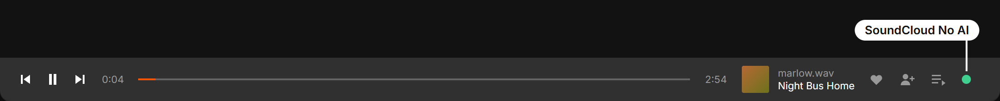
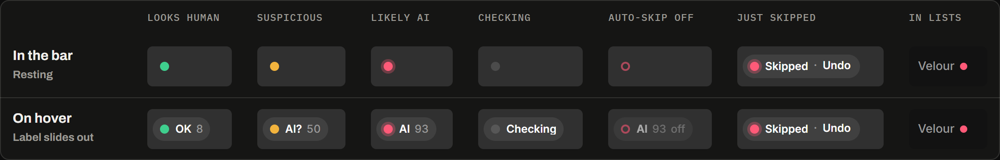
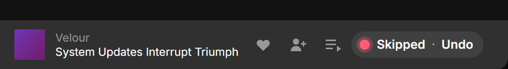
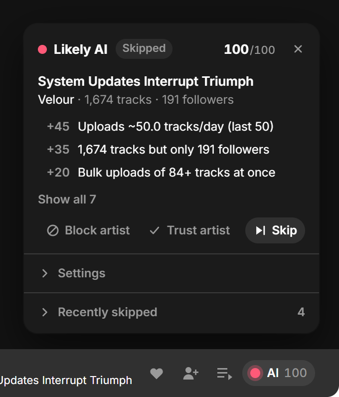
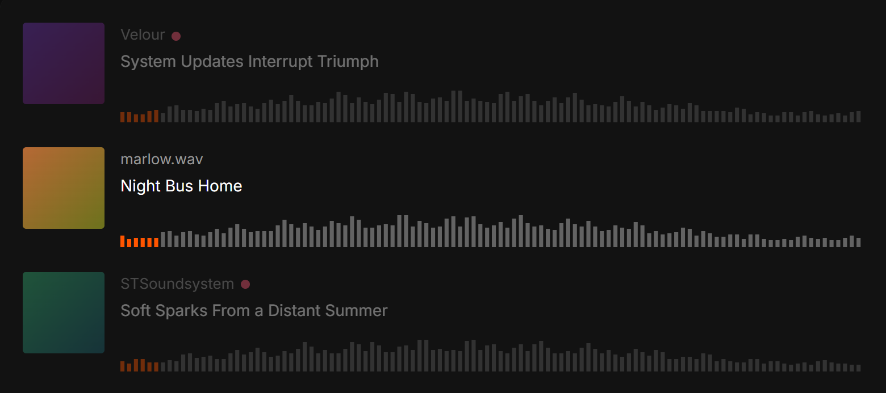

# SoundCloud No AI

Skips AI-generated songs on SoundCloud while you listen. All you see is one small dot in the player bar.



SoundCloud doesn't label AI music. Every time a new song starts, SoundCloud No AI looks at who uploaded it, the way you would if you had the time. Do they post dozens of songs a day? Thousands of songs but almost no followers? Do they write "made with Suno"? If the song looks AI-made, it gets skipped and the next one plays.

## Install

1. Add the free browser extension [Tampermonkey](https://www.tampermonkey.net/) (Chrome, Firefox, Edge, Safari, Opera). [Violentmonkey](https://violentmonkey.github.io/) works too.
2. Click **[Install SoundCloud No AI](https://raw.githubusercontent.com/Oblivios/SoundCloudNoAI/main/soundcloud-no-ai.user.js)**, then **Install** on the page that opens. Updates arrive automatically.
3. Open soundcloud.com and play something. The dot appears in the player bar.

On Chrome and Edge, if nothing shows up, open the extension's details page and switch on **Allow User Scripts**.

## What the dot means



| Dot | Meaning |
| --- | --- |
| Green | Looks human. Keeps playing. |
| Amber | Suspicious. Keeps playing (you can choose to skip these too). |
| Red | Likely AI. Skipped. |
| Grey | Checking the song. Takes about a second. |
| Hollow ring | Nothing is playing yet, or auto-skip is turned off. |

Hover the dot to see its label and a score from 0 (human) to 100 (AI).

## When a song gets skipped



For a few seconds the dot reads **Skipped · Undo**. Click **Undo** to bring the song back.

It stays out of your way:

- It only skips songs that come on by themselves: autoplay, stations, the next song in a playlist.
- A song you start yourself always plays, and so do that artist's other songs until you reload the page. You can still open an AI artist's page and listen on purpose.
- If you press play, next or previous while it's still checking a song, it leaves that song to you instead of skipping.
- If AI songs keep coming one after another, it pauses after a few instead of skipping through them all.

## See why



Click the dot to open the panel. It shows:

- **Why** the song got its score, reason by reason.
- **Block artist** always skips them. **Trust artist** never skips them, if it got a real artist wrong. **Skip** skips this song now.
- **Settings**: turn auto-skip on or off, also skip suspicious songs, mark AI artists in lists, and choose how strict it is.
- **Recently skipped**: the last songs it skipped, with links.

Press Esc or click anywhere else to close it.

## In your feed and search



Once an artist has been found to be AI, their songs are faded out in your feed, search results and playlists, with a small red dot after their name. Hover a song to see it normally.

The dot, the panel and the faded songs follow SoundCloud's light or dark theme.

## Good to know

- It's a well-informed guess, not a certainty. A careful AI uploader who posts slowly and builds a real audience will get through, and a real artist who uploads hundreds of songs to a new account can look suspicious. **Trust** and **Block** fix those cases.
- A song can play for a moment before it's skipped: a fraction of a second for an artist it already knows, a second or two the first time.
- It works on soundcloud.com in a computer browser, not in the SoundCloud apps.

## Privacy

It only talks to SoundCloud, reading the same public information soundcloud.com itself loads, without your cookies. Your settings, block and trust lists stay in your browser. Nothing is sent anywhere else.

## How it decides

When a new song starts, the script asks SoundCloud's web API for the song, the uploader and their ~40 most recent uploads. The uploader's data is kept for 12 hours, so the next song by the same artist is judged instantly. Each clue adds or removes points; at 60 the song is skipped, from 35 it's suspicious.

| Clue | Points | Why it works |
| --- | --- | --- |
| Upload-pipeline job tag in a description, e.g. `[owmp-job:space_mango_next_200_20260930:20]` | +100 | Automation leaking into the metadata |
| The song says it's AI ("Suno AI", "made with AI", "AI cover", "généré par IA", "KI-generiert"…) | +70 | Self-disclosure |
| The profile bio says it / 3+ recent uploads say it | +60 | |
| Songwriter credit already seen on *another* flagged account | +50 | Farms run many fake "artists" under one composer (e.g. Space Mango and STSoundsystem are both "Oliver Wolff") |
| Upload rate over the last 20–50 songs: ≥ 8/day · ≥ 3/day · ≥ 1.5/day | +45 · +25 · +10 | Humans don't release 50 songs a day |
| 30+ (or 20+) songs uploaded within 24 h | +25 (+10) | Mass batch uploads |
| Hundreds of songs scheduled for future release | +25 | SoundCloud hides these as empty pages. Farms queue months ahead |
| Catalogue vs. audience (≥ 150 songs): ≥ 5× · ≥ 2× · ≥ 1× more songs than followers | +35 · +20 · +8 | 1,674 songs and 191 followers is not a human career |
| Same title regenerated in several styles: "To Her (Folk Rock)", "To Her (Celtic Ballad)"… | +20 | Classic Suno/Udio output |
| Bulk uploads of 40+ songs at once (from the link: `wireframe-80`) | +20 | Albums stay under ~30 |
| Most titles carry a style tag: "(Viking Music)", "(Electronic, House)" | +15 | Prompt text in the title |
| 1000+ songs with < 2000 followers | +10 | |
| < 150 plays after a week | +10 | Weak on its own: new human songs have few plays too |
| Follows nobody · Pro Unlimited with a small audience · default avatar · hidden play count | +8 · +5 · +5 · +5 | Weak hints |
| Verified · 100k / 20k / 5k followers · 5+ comments · 100+ likes | −100 · −60/−35/−15 · −10 · −10 | Evidence of a real audience |

The thresholds were calibrated on ~270 uploaders: SoundCloud's related tracks for four known AI-farm tracks, plus recent search results for lofi, techno, house, ambient, rap and indie, plus artists related to a mainstream track.

- 26 flagged as AI. Every one of them either declares AI itself or has a clear farm pattern.
- 9 suspicious.
- 234 OK, including album drops, label catalogue uploads, type-beat producers and people bulk-uploading old voice memos.

The four AI-farm tracks are kept as test fixtures in `test/fixtures/` and all score 100.

## For developers

Node 18+ (22+ for the browser tools). No dependencies.

```bash
npm test
```

```bash
node tools/check.mjs https://soundcloud.com/velour02/system-updates-interrupt-triumph-46
```

`tools/check.mjs` scores any track from the terminal with the same code the userscript uses. Found a miss or a false positive? Save it as a test fixture and adjust the scoring until `npm test` passes:

```bash
node tools/check.mjs <track-url> --save ai
```

```bash
node tools/e2e.mjs https://soundcloud.com/velour02/tracks https://soundcloud.com/flume/tracks
```

`tools/e2e.mjs` is a live smoke test. It opens the pages in a headless Chrome/Edge, injects the script and reports what the player bar shows. SoundCloud asks logged-out sessions to sign in before playing, so the test fakes the "now playing" link instead. Everything except the final click on "next" gets exercised.

```bash
node tools/race.mjs
```

`tools/race.mjs` checks, offline, that a skip never lands on a song you chose yourself. An AI track is still being checked when you press play on another song or press next. SoundCloud's "now playing" link keeps showing the AI track until the new one has loaded, so a skip at that moment would hit your song.

```bash
node tools/screenshots.mjs
```

`tools/screenshots.mjs` redraws the pictures in `assets/`. They come from `tools/preview.mjs`, which renders the script's own UI templates on a mock SoundCloud player (`node tools/preview.mjs` writes it to `docs/styles.html`).

The scoring lives at the top of `soundcloud-no-ai.user.js` as pure functions (`scoreTrack`, `uploadStats`, …). The UI is a separate pure block (`// <ui>` … `// </ui>`: data in, HTML out) that the preview copies verbatim. The file is also a CommonJS module, so the tests `require` it directly.

## License

MIT
